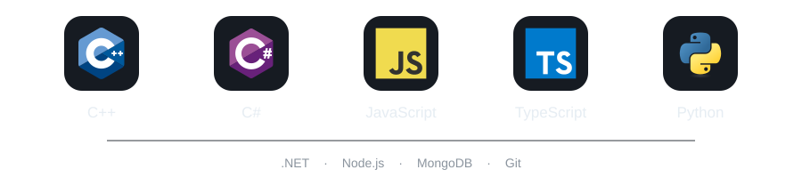

    

<h1 align="center">Hey there, I'm Xinoss</h1>

  

  &nbsp;&nbsp;
  

  &nbsp;&nbsp;
  

---

<picture>
  <source media="(prefers-color-scheme: light)" srcset="https://raw.githubusercontent.com/xinoss/xinoss/main/.github/assets/about-light.svg">
  <source media="(prefers-color-scheme: dark)" srcset="https://raw.githubusercontent.com/xinoss/xinoss/main/.github/assets/about-dark.svg">
  
</picture>

    <h2>Languages &amp; Tools</h2>
    

        <picture>
            <source media="(prefers-color-scheme: light)" srcset="https://raw.githubusercontent.com/xinoss/xinoss/main/.github/assets/stack-light.svg">
            <source media="(prefers-color-scheme: dark)" srcset="https://raw.githubusercontent.com/xinoss/xinoss/main/.github/assets/stack-dark.svg">
            
        </picture>
    

    <h2>Find Me</h2>
    

         
        &nbsp;&nbsp;
        &nbsp;&nbsp;
        
    

    <h2>GitHub Stats</h2>
    

        
        
    

